# Anfas — Business Page Automation

[](https://n8n.io/)
[](https://www.postgresql.org/)
[](https://openai.com/)
[](https://developers.facebook.com/)
[](https://telegram.org/)
[](LICENSE)

An enterprise-grade, end-to-end automation platform designed for **Anfas Fragrance & Perfume Retail** (Bangladesh). Built using **n8n**, **PostgreSQL**, **OpenAI (LangChain)**, and **Meta Graph API**, this suite automates multi-channel customer engagement across Facebook & Instagram, conversational Cash on Delivery (COD) ordering, social media marketing publishing, comment auto-moderation, daily executive KPI reporting, and centralized error monitoring.

---

## Table of Contents

1. [System Architecture](#system-architecture)
2. [Workflow Ecosystem](#workflow-ecosystem)
   - [WF00: Database Schema Setup](#wf00---database-schema-setup)
   - [WF01: Meta Inbound Webhook](#wf01---meta-inbound-webhook)
   - [WF02: AI Customer Support](#wf02---ai-customer-support)
   - [WF03: Order Management (COD)](#wf03---order-management-cod)
   - [WF04: Image to Post Pipeline](#wf04---image-to-post-pipeline)
   - [WF05: Comment Automation](#wf05---comment-automation)
   - [WF06: Daily Executive Report](#wf06---daily-executive-report)
   - [WF07: Error Monitoring & Alerting](#wf07---error-monitoring--alerting)
3. [Database Architecture & Data Model](#database-architecture--data-model)
4. [Environment Variables & Credentials](#environment-variables--credentials)
5. [Installation & Deployment Guide](#installation--deployment-guide)
6. [Business Logic & Guardrails](#business-logic--guardrails)
7. [Repository File Structure](#repository-file-structure)

---

## System Architecture

### Component & Data Flow Diagram

```mermaid
flowchart TB
    %% Styling Classes
    classDef metaChannel fill:#E7F3FF,stroke:#1877F2,stroke-width:2px,color:#0B3C68;
    classDef driveChannel fill:#FFF8E1,stroke:#F59E0B,stroke-width:2px,color:#78350F;
    classDef gatewayNode fill:#F3E8FF,stroke:#9333EA,stroke-width:2px,color:#581C87;
    classDef coreWorkflow fill:#FFE4E6,stroke:#E11D48,stroke-width:2px,color:#881337;
    classDef aiService fill:#DCFCE7,stroke:#16A34A,stroke-width:2px,color:#14532D;
    classDef databaseNode fill:#E0F2FE,stroke:#0284C7,stroke-width:2px,color:#0C4A6E;
    classDef telegramNode fill:#E0F7FA,stroke:#00ACC1,stroke-width:2px,color:#004D40;
    classDef errorWorkflow fill:#FEE2E2,stroke:#DC2626,stroke-width:2px,color:#7F1D1D;

    %% Layer 1: Client Ingestion
    subgraph L1 ["1. Client & Ingestion Channels"]
        FBM["Facebook Messenger & Page<br/>(DMs, Postbacks, Comments)"]:::metaChannel
        IGM["Instagram Direct & Profile<br/>(DMs, Story Replies, Comments)"]:::metaChannel
        GDR["Google Drive Marketing Folder<br/>(New Fragrance Images)"]:::driveChannel
    end

    %% Layer 2: Gateway & Verification
    subgraph L2 ["2. Gateway & Security Ingestion"]
        WF01["WF01 - Meta Inbound Webhook<br/>- GET: hub.challenge Handshake<br/>- POST: HMAC-SHA256 Auth<br/>- Deduplication Ledger Check<br/>- Async Workflow Router"]:::gatewayNode
    end

    %% Layer 3: Automation Core
    subgraph L3 ["3. Orchestration & Business Logic (n8n Core)"]
        WF02["WF02 - AI Customer Support<br/>- 24h Window Validation<br/>- Bilingual RAG Generation<br/>- Human Handoff Routing"]:::coreWorkflow
        WF03["WF03 - Order Management<br/>- Conversational COD Checkout<br/>- Dynamic Dhaka Delivery Fees<br/>- Real-Time Stock Validation"]:::coreWorkflow
        WF04["WF04 - Image to Post Pipeline<br/>- Vision Aesthetic Analysis<br/>- Telegram Approval Gating<br/>- Dual-Channel Publishing"]:::coreWorkflow
        WF05["WF05 - Comment Automation<br/>- Sentiment & Intent Filter<br/>- Public & Private Auto-Replies<br/>- Toxic / Spam Auto-Hide"]:::coreWorkflow
        WF06["WF06 - Daily Executive Report<br/>- 21:00 Dhaka Cron Trigger<br/>- Previous-Day Metrics Aggregation<br/>- Low-Stock & Sales Alerts"]:::coreWorkflow
    end

    %% Layer 4: AI & Machine Learning Intelligence
    subgraph L4 ["4. AI & Machine Learning Services"]
        LLM_INTENT["OpenAI GPT-4o<br/>(Intent & Sentiment Classifier)"]:::aiService
        LLM_REPLY["OpenAI GPT-4o<br/>(RAG Fact-Grounded Response)"]:::aiService
        LLM_VISION["OpenAI Vision API<br/>(Image Descriptor & Scent Notes)"]:::aiService
    end

    %% Layer 5: Data & Persistence
    subgraph L5 ["5. Data Persistence & State Machine"]
        DB[("PostgreSQL 14+ Relational Database<br/>- products & stock_quantity<br/>- customers & consent_status<br/>- conversations & order_state<br/>- orders & order_items<br/>- webhook_events & workflow_errors")]:::databaseNode
    end

    %% Layer 6: Staff & Operations
    subgraph L6 ["6. Staff Supervision & Operations"]
        TG["Telegram Operations Channel<br/>- Instant Order Notifications<br/>- Human Escalation Alerts<br/>- Interactive Post Approvals<br/>- Daily 21:00 Business Briefing"]:::telegramNode
    end

    %% Layer 7: Reliability Sentinel
    subgraph L7 ["7. Centralized Reliability Sentinel"]
        WF07["WF07 - Error Monitoring Sentinel<br/>- Secret & Credential Redaction<br/>- 30-Minute Storm Throttling<br/>- PostgreSQL Audit Logging<br/>- Urgent Admin Dispatch"]:::errorWorkflow
    end

    %% External Trigger Flows
    FBM -->|Webhook HTTP POST| WF01
    IGM -->|Webhook HTTP POST| WF01
    GDR -->|Drive Polling Trigger| WF04

    %% WF01 Event Dispatch
    WF01 -->|Messenger & DM Inbound| WF02
    WF01 -->|Order Confirmation Callback| WF03
    WF01 -->|Post & Reel Comments| WF05
    WF01 <-->|Deduplication & Event Logging| DB

    %% WF02 Flows
    WF02 <-->|Intent Classification| LLM_INTENT
    WF02 <-->|Context & Product RAG| DB
    WF02 <-->|Structured Reply Generation| LLM_REPLY
    WF02 -->|Order Intent Handoff| WF03
    WF02 -->|Escalate to Human Agent| TG
    WF02 -->|Send Reply Message| FBM
    WF02 -->|Send Reply Message| IGM

    %% WF03 Flows
    WF03 <-->|Address & Item Extraction| LLM_INTENT
    WF03 <-->|Stock Check & Order State Machine| DB
    WF03 -->|Send Order Summary & Invoice| FBM
    WF03 -->|Send Order Summary & Invoice| IGM
    WF03 -->|Alert New Confirmed Order| TG

    %% WF04 Flows
    WF04 <-->|Visual & Note Extraction| LLM_VISION
    WF04 <-->|Product Match & Draft Storage| DB
    WF04 -->|Approval Prompt with Photo Preview| TG
    TG -->|Interactive Callback: Approve / Reject| WF04
    WF04 -->|Publish Photo Feed Post| FBM
    WF04 -->|Create Container & Publish| IGM

    %% WF05 Flows
    WF05 <-->|Comment Intent Analysis| LLM_INTENT
    WF05 <-->|Price & Variant Check| DB
    WF05 -->|Public Comment & Private DM| FBM
    WF05 -->|Negative Feedback / Complaint Alert| TG

    %% WF06 Flows
    WF06 -->|Run Analytical Aggregate Query| DB
    WF06 -->|Deliver 21:00 Dhaka Report| TG

    %% Global Error Routing
    L2 -.->|On Node Error| WF07
    L3 -.->|On Node Error| WF07
    WF07 -->|Sanitized Audit Record| DB
    WF07 -->|Dispatch Urgent Alert| TG
```



---

### Subsystem Communication Matrix

| Subsystem / Node | Source | Destination | Protocol / Method | Primary Payload / Action | Resilience & Guardrails |
|---|---|---|---|---|---|
| **Meta Ingestion** | Facebook / Instagram | `WF01` | HTTPS POST | Webhook JSON (messages, postbacks, comments) | HMAC SHA-256 signature check; payload hash deduplication |
| **Customer Support** | `WF01` | `WF02` | n8n Sub-workflow | Inbound message text, sender ID, platform | 24-hour Meta messaging window enforcement; strict RAG fact retrieval |
| **Order Processing** | `WF02` / `WF01` | `WF03` | n8n Sub-workflow | Customer phone, address, item SKU, quantity | Database-enforced status transitions; dynamic Dhaka delivery fees |
| **Content Creation** | Google Drive | `WF04` | Google Drive API | Product image binary | Hash check to prevent duplicate drafts; Telegram approval required |
| **Social Publishing**| `WF04` | Meta Graph API | HTTPS POST | Single Photo (FB) / Media Container (IG) | Unpublished photo hosting for Instagram; polling container status |
| **Comment Guard** | `WF01` | `WF05` | n8n Sub-workflow | Comment text, post ID, comment ID | Deduplication claim in DB; auto-hide spam; public & private replies |
| **Daily Analytics** | PostgreSQL | `WF06` $\rightarrow$ Telegram | HTTPS POST (Bot API) | Aggregated KPIs (chats, orders, revenue, stock) | Previous-day Dhaka timezone filter; duplicate dispatch prevention |
| **Error Sentinel** | All Workflows | `WF07` | n8n Error Trigger | Execution error object, failed node, execution URL | Automatic secret token redaction; 30-minute alert storm throttling |

---

## Workflow Ecosystem

### WF00 - Database Schema Setup
* **File:** [`WF00 - Database Schema Setup.json`](file:///d:/Automation/Business%20Page%20Automation/WF00%20-%20Database%20Schema%20Setup.json) | SQL: [`wf00_schema.sql`](file:///d:/Automation/Business%20Page%20Automation/wf00_schema.sql)
* **Trigger:** Manual execution trigger (One-time setup / Migrations).
* **Key Functionality:**
  - Idempotently creates 11 core tables, indices, triggers, and sequences using `CREATE ... IF NOT EXISTS`.
  - Establishes relational integrity constraints for products, conversations, messages, orders, and errors.
  - Deploys database triggers (`fn_set_updated_at` and `fn_orders_enforce_status_transitions`) to enforce state machine rules at the database level.
  - Seeds store settings for **Anfas** (Currency: `BDT`, Timezone: `Asia/Dhaka`, Default Language: `bn`).

### WF01 - Meta Inbound Webhook
* **File:** [`WF01 - Meta Inbound Webhook.json`](file:///d:/Automation/Business%20Page%20Automation/WF01%20-%20Meta%20Inbound%20Webhook.json)
* **Trigger:** Webhook endpoints for Meta Webhook verification (`GET`) and event ingestion (`POST`).
* **Key Functionality:**
  - **Handshake Verification:** Validates `hub.mode` and `hub.verify_token` against `$vars.META_VERIFY_TOKEN` and echoes `hub.challenge`.
  - **HMAC SHA-256 Authentication:** Computes HMAC signature of the raw body using the Meta App Secret and validates `X-Hub-Signature-256`.
  - **Immediate Acknowledgment:** Returns HTTP 200 within Meta's timeout limit to prevent retry storms.
  - **Deduplication:** Hashes payload and checks the `webhook_events` table to prevent re-processing duplicated events.
  - **Dynamic Routing:**
    - Incoming DMs and Messenger messages $\rightarrow$ **WF02 - AI Customer Support**
    - Order callbacks $\rightarrow$ **WF03 - Order Management**
    - Feed comments $\rightarrow$ **WF05 - Comment Automation**

### WF02 - AI Customer Support
* **File:** [`WF02 - AI Customer Support.json`](file:///d:/Automation/Business%20Page%20Automation/WF02%20-%20AI%20Customer%20Support.json)
* **Trigger:** Executed by `WF01`.
* **Key Functionality:**
  - **Guardrail Check:** Verifies Meta's 24-hour messaging window and ensures conversation status is `open` (skips if in `human_handover`).
  - **Intent Classification:** LangChain LLM classifies message intent into 11 categories:
    `greeting`, `product_price`, `product_details`, `availability`, `delivery`, `order_start`, `order_status`, `return_policy`, `complaint`, `human_request`, `unknown`.
  - **Fact-Grounded RAG:** Retrieves real-time product prices, stock status, and FAQs from PostgreSQL to strictly prevent hallucinations regarding notes, sizing, or prices.
  - **Bilingual Generation:** Generates culturally natural responses in Bengali or English.
  - **Action Routing:**
    - `order_start` $\rightarrow$ Hands off directly to **WF03**.
    - `complaint` / `human_request` $\rightarrow$ Escalates conversation to `human_handover` and alerts human agent on Telegram.
    - Standard inquiry $\rightarrow$ Dispatches message via Meta Graph API (Messenger/Instagram) and records outbound message.

### WF03 - Order Management (COD)
* **File:** [`WF03 - Order Management.json`](file:///d:/Automation/Business%20Page%20Automation/WF03%20-%20Order%20Management.json)
* **Trigger:** Sub-workflow triggered by `WF01` or `WF02`.
* **Key Functionality:**
  - **Conversational Checkout State Machine:**
    - `collecting`: Extracts desired fragrance variant, quantity, customer full name, Bangladeshi phone number (`01XXXXXXXXX`), and full delivery address.
    - Delivery Fee Resolution: Computes delivery fee dynamically based on customer location (`delivery_fee_inside_dhaka` vs `delivery_fee_outside_dhaka` from `store_settings`).
    - `awaiting_confirmation`: Formats itemized order summary with subtotal, shipping fee, and grand total in BDT, prompting customer for confirmation ("হ্যাঁ" / "Yes").
    - `confirmed`: Validates real-time inventory from `products`, provisions sequential order ID (`ORD-YYMMDD-XXXXXX`), inserts `order_items`, and confirms order.
  - **Admin Telegram Notification:** Immediately notifies business management with full customer and order details for order dispatch.

### WF04 - Image to Post Pipeline
* **File:** [`WF04 - Image to Post.json`](file:///d:/Automation/Business%20Page%20Automation/WF04%20-%20Image%20to%20Post.json)
* **Trigger:** Google Drive Trigger (Monitors designated marketing asset folder).
* **Key Functionality:**
  - **Deduplication:** Computes file hash and verifies image has not been previously queued.
  - **Vision Analysis:** Uses OpenAI Vision to analyze fragrance bottle aesthetic, color palette, and mood.
  - **Catalog Matching & Copywriting:** Matches visual features with product database and generates channel-optimized captions (Facebook & Instagram) with targeted hashtags and pricing.
  - **Human-in-the-Loop Approval:** Sends interactive Telegram draft with image preview and inline **[Approve]** / **[Reject]** buttons.
  - **Publishing Engine:**
    - **Facebook:** Directly publishes photo post to Page.
    - **Instagram:** Uploads unpublished photo to Page to acquire secure hosted public URL, creates Instagram Media Container, polls for container readiness, and publishes post.

### WF05 - Comment Automation
* **File:** [`WF05 - Comment Automation.json`](file:///d:/Automation/Business%20Page%20Automation/WF05%20-%20Comment%20Automation.json)
* **Trigger:** Sub-workflow triggered by `WF01` on feed comment webhooks.
* **Key Functionality:**
  - **Sentiment & Intent Classification:** Identifies pricing queries, compliments, spam, or grievances.
  - **Product Data Grounding:** Pulls verified perfume pricing and sizing before answering publicly.
  - **Multi-Pronged Execution:**
    - **Public Reply:** Posts polite, helpful public reply on the comment thread.
    - **Private Reply:** Dispatches direct private message via Meta Graph API inviting customer into DM for checkout.
    - **Auto-Moderation:** Automatically hides offensive, vulgar, or spam comments.
    - **Grievance Escalation:** Alerts admins on Telegram if negative feedback or order complaints are detected.

### WF06 - Daily Executive Report
* **File:** [`WF06 - Daily Report.json`](file:///d:/Automation/Business%20Page%20Automation/WF06%20-%20Daily%20Report.json)
* **Trigger:** Scheduled cron running daily at **21:00 Asia/Dhaka**.
* **Key Functionality:**
  - Analyzes the previous complete calendar day (Dhaka timezone).
  - Summarizes key business KPIs:
    - Inbound conversations & unique customers.
    - Confirmed orders & gross BDT volume.
    - Channel distribution (Facebook vs Instagram).
    - Low-stock inventory warnings.
    - Pending human escalation tickets.
  - Deduplicates via `daily_reports` table (never sends duplicate digests).
  - Dispatches an executive summary directly to the Admin Telegram channel.

### WF07 - Error Monitoring & Alerting
* **File:** [`WF07 - Error Monitoring.json`](file:///d:/Automation/Business%20Page%20Automation/WF07%20-%20Error%20Monitoring.json)
* **Trigger:** n8n Error Trigger (Bound as Error Workflow for WF01 through WF06).
* **Key Functionality:**
  - **Sensitive Data Sanitization:** Strips tokens, passwords, authorization headers, and secrets before logging.
  - **Incident Audit Logging:** Records error traceback, failed node name, workflow name, execution ID, and direct n8n execution URL into `workflow_errors`.
  - **Storm Throttling:** Suppresses repetitive alerts for identical errors occurring within a 30-minute window.
  - **Telegram Dispatch:** Delivers instant, high-priority incident notifications to developers and operations staff.

---

## Database Architecture & Data Model

The database is built on PostgreSQL with strict check constraints, foreign keys, and trigger-enforced state transitions.

```
├── products               --> Sellable perfume variants (SKU, scent notes, size_ml, price_bdt, stock)
├── customers              --> Multi-channel customer profiles (platform, platform_user_id, phone, address)
├── conversations          --> Chat sessions with status (open, human_handover, resolved, closed) & order_state
├── messages               --> Message history (inbound/outbound, intent, delivery status)
├── webhook_events         --> Meta webhook deduplication & idempotency ledger
├── orders                 --> COD orders (ORD-YYMMDD-XXXXXX) with strict status transitions
├── order_items            --> Itemized line items linked to products with price snapshots
├── faqs                   --> Grounded question-answer pairs for customer support RAG
├── store_settings         --> Key-value configuration (business name, delivery fees, default language)
├── content_queue          --> Social media publishing pipeline (draft, review, approved, published)
├── workflow_errors        --> Execution error audit logs with retry tracking
└── daily_reports          --> Sent daily analytical report logs (prevent duplicate dispatch)
```

### Order Status State Machine
Orders enforce strict non-reversible lifecycle states:
```
           ┌───────────┐
           │   draft   │──────┐
           └─────┬─────┘      │
                 │            │
                 ▼            │
           ┌───────────┐      │
           │ confirmed │──────┤
           └─────┬─────┘      │
                 │            │
                 ▼            ▼
           ┌───────────┐ ┌───────────┐
           │processing │ │ cancelled │
           └─────┬─────┘ └───────────┘
                 │            ▲
                 ▼            │
           ┌───────────┐      │
           │  shipped  ├──────┘
           └─────┬─────┘
                 │
                 ▼
           ┌───────────┐
           │ delivered │
           └───────────┘
```

---

## Environment Variables & Credentials

### n8n Variables (`$vars`)

Configure these variables inside your n8n workspace (**Settings** $\rightarrow$ **Variables**):

| Variable Name | Description | Example / Format |
|---|---|---|
| `ADMIN_TELEGRAM_CHAT_ID` | Telegram Chat ID or Channel ID where alerts and reports are delivered | `-1001234567890` or `123456789` |
| `META_VERIFY_TOKEN` | Secret verification token configured in Meta Developer Portal for Webhooks | `anfas_meta_secret_token_2026` |
| `META_PAGE_ID` | Facebook Page ID for Anfas Fragrance | `102938475610293` |
| `IG_USER_ID` | Instagram Professional / Business Account ID | `17841400123456789` |
| `META_GRAPH_API_VERSION` | Version of Meta Graph API used for calls | `v23.0` |

### n8n Credentials

Configure the following credentials in n8n (**Credentials** $\rightarrow$ **New Credential**):

| Credential Type | Identifier in Workflows | Required Permissions / Notes |
|---|---|---|
| **Postgres** | `postgres` | Standard PostgreSQL connection (Host, Port, User, Password, Database). |
| **OpenAI API** | `openAiApi` | OpenAI API Key (Access to `gpt-4o`, `gpt-4o-mini`, and Vision). |
| **Telegram API** | `telegramApi` | Telegram Bot Token obtained from [@BotFather](https://t.me/botfather). |
| **Facebook Graph API** | `facebookGraphApi` | Page Access Token with `pages_messaging`, `pages_read_engagement`, `pages_manage_posts`, and `instagram_basic`. |
| **Google Drive OAuth2** | `googleDriveOAuth2Api` | Read-only / download access to Google Drive asset folder. |
| **Crypto Secret** | Used in WF01 | Meta App Secret used for HMAC-SHA256 signature verification. |

---

## Installation & Deployment Guide

### 1. Database Initialization
Execute the schema script against your PostgreSQL database:
```bash
psql -h <host> -U <user> -d <database_name> -f wf00_schema.sql
```
*Alternatively, import and run `WF00 - Database Schema Setup.json` inside n8n.*

### 2. Configure Store Settings
Update operational constants in the `store_settings` table:
```sql
INSERT INTO store_settings (setting_key, setting_value) VALUES
  ('delivery_fee_inside_dhaka',  '70'),
  ('delivery_fee_outside_dhaka', '130')
ON CONFLICT (setting_key) DO UPDATE SET setting_value = EXCLUDED.setting_value;
```

### 3. Import Workflows into n8n
1. Open n8n $\rightarrow$ **Workflows** $\rightarrow$ **Import from File**.
2. Import all workflows in order:
   - `WF07 - Error Monitoring.json` *(Publish first)*
   - `WF00 - Database Schema Setup.json`
   - `WF06 - Daily Report.json`
   - `WF05 - Comment Automation.json`
   - `WF03 - Order Management.json`
   - `WF02 - AI Customer Support.json`
   - `WF04 - Image to Post.json`
   - `WF01 - Meta Inbound Webhook.json`

### 4. Link Sub-Workflows & Error Workflows
1. In `WF01`, open the three **Execute Workflow** nodes and select `WF02`, `WF03`, and `WF05`.
2. In `WF02`, open the **Hand Off to WF03** node and select `WF03`.
3. In each workflow settings (Workflow Settings $\rightarrow$ **Error Workflow**), select **WF07 - Error Monitoring**.

### 5. Meta Webhook Configuration
1. Go to **Meta for Developers** $\rightarrow$ Your App $\rightarrow$ **Webhooks** $\rightarrow$ **Page / Instagram**.
2. **Callback URL:** `https://<your-n8n-domain>/webhook/meta-webhook`
3. **Verify Token:** Must match `META_VERIFY_TOKEN`.
4. Subscribe to fields: `messages`, `messaging_postbacks`, `feed`, `mention`.

---

## Business Logic & Guardrails

### 1. Zero-Hallucination Customer Service
- The AI model in `WF02` is strictly constrained to data retrieved via RAG from the `products` table and `faqs` table.
- If a customer inquires about perfume scent notes, bottle size, or pricing that is not confirmed in the database, the AI defaults to inviting a human agent rather than inventing details.

### 2. 24-Hour Messaging Policy
- Facebook and Instagram impose a strict 24-hour response window on standard customer DMs.
- `WF02` and `WF03` verify inbound message timestamps and use standard `RESPONSE` tags within 24 hours.

### 3. Strict Cash on Delivery (COD) Rules
- In compliance with Bangladesh e-commerce practices, payment status remains `pending` upon order creation.
- An order is **never** marked `paid` without verified financial transaction evidence (e.g., bKash/Nagad merchant verification).
- An order draft is only promoted to `confirmed` after explicit user agreement and inventory stock verification.

### 4. Human-in-the-Loop Content Publishing
- Automated AI social media drafts generated by `WF04` never publish without explicit human approval via Telegram.

---

## Repository File Structure

```
.
├── WF00 - Database Schema Setup.json   # n8n: Automated database initialization workflow
├── WF01 - Meta Inbound Webhook.json    # n8n: Meta webhook gateway & HMAC authentication
├── WF02 - AI Customer Support.json     # n8n: LangChain intent classification & RAG support
├── WF03 - Order Management.json        # n8n: Conversational Cash on Delivery ordering
├── WF04 - Image to Post.json           # n8n: Social media vision analysis & publishing
├── WF05 - Comment Automation.json      # n8n: Post comment auto-reply & moderation
├── WF06 - Daily Report.json            # n8n: Daily 21:00 Dhaka business performance digest
├── WF07 - Error Monitoring.json        # n8n: Centralized incident capture & alert dispatch
├── wf00_schema.sql                     # PostgreSQL idempotent database schema & triggers
└── README.md                           # Comprehensive documentation & deployment guide
```

---

## License

This project is proprietary and maintained for **Anfas Fragrance Retail**. All rights reserved. Distributed under the MIT License.
